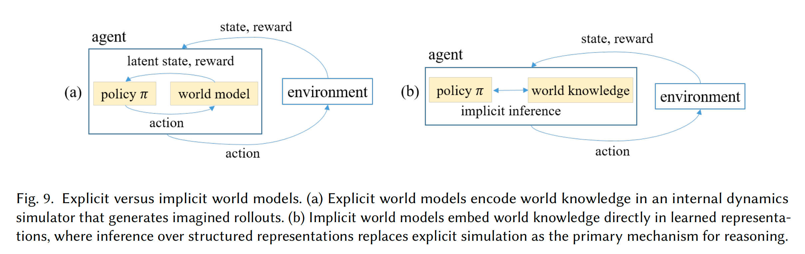
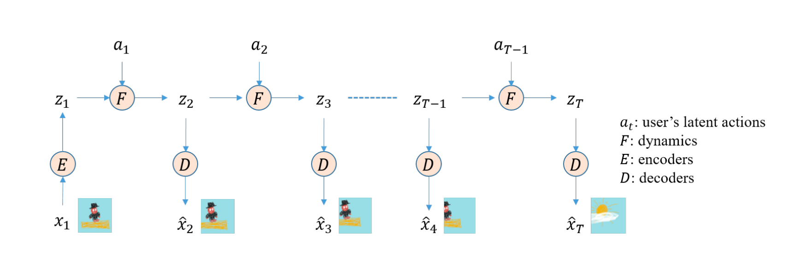
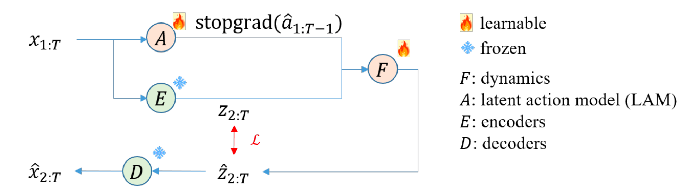
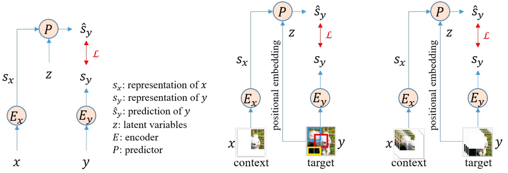

> **阅读说明：** 本文整理自 Il-Seok Oh 的论文 *A Tutorial on World Models and Physical AI* （发布于2026年8月，ACM Computing Surveys)

书接上回，继续讲当时未完的 Implicit World Model 部分

# Explicit vs Implicit

两者的区别在于模型如何表示并预测世界：**explicit world model** 显式构造可解释的结构化状态（如物体、位置和关系）及其变化规则，再在该表示上进行 rollout；**implicit world model** 则不要求这些变量或规则被明确拆解出来，而是直接在学习到的潜在表示中预测未来观测或特征。Implicit 并不等于没有内部表示，而是其表示与预测机制通常不以显式、可解释的世界结构呈现。
<figure>
  
</figure>

（Emmm......以上内容纯属 AI 生成，我研究半天都没搞明白这俩到底有啥区别，反正应该只是个不太重要的定义，大概看看就行）（我看 AI 有的时候自己都说不清这俩谁是谁）

# Generative Video World Models: Genie
让 AI 根据一段视频生成后续是一个常见的任务，但是有时候未来未必直觉性地唯一。如果看到一个小球在空中，我们可以预测它会往下落，但如果看到一辆车行驶到十字路口，我们却未必能清楚地知道它要往哪里走。于是 Google DeepMind 开发出了一个能根据历史视频与动作指令输入生成未来视频的系统：**Genie**

Genie 的整体结构其实非常的简单，如下图：

<figure>
  
</figure>

于是我们重点看训练：
<figure>
  
</figure>

依旧采用分层训练的方式，先训练 Encoder-Decoder，再训练 Action 和 Dynamic 部分。Encoder-Decoder 部分采用[VQ-VAE](/2026/10/16/0009/)架构，可以参见相对应文章，本篇不再重复，这里重点说说 LAM 与 dynamics。

作为 implicit world model，Genie 并未设计单独的 policy 神经网络。其他的显示世界模型一般都是将神经网络学习到的 latent state 映射到人为设定的 actions 上面。这里 Genie 则采用了完全不同的方向。它并没有需要人为设定动作，而是让神经网络根据视频的内容去学习、识别其中的动作。这里的 A 会将 $t-1$ 时刻的输入的视频转化为一个动作状态（以无法直接被人类所理解的向量形式存在）。随后的 F 则是输入来自 A 的 $t-1$ 时刻动作与来自 Encoder 的 $t-1$ 时刻状态输出，在输出 $t$ 时刻的外推状态，并与 Encoder 输出的实际 $t$ 时刻状态对比计算 loss。

ps: 最后会让工作人员人工地去看 LAM 学到的动作，并人工分类、命名

# Joint-Embedding Predictive Architectures (JEPA)

前面的 Genie 虽然也会在 latent space 中预测，但最终还是要把结果还原成一段能看的视频。JEPA 则更进一步：既然我们想要的是理解世界，那为什么一定要让 AI 把未来的画面画出来？

还是拿前面的小球举例。如果想知道它接下来会怎么运动，我们真正关心的可能是它的位置、运动方向，以及会不会撞上其他东西，而不是背景里的每一片树叶长什么样。生成视频需要处理这些具体的画面细节，但并不是所有细节都对理解这件事有帮助。于是 JEPA 选择直接预测 Encoder 输出的 representation，而不再将它还原成原始图像。

所以这里的 predict --> represent 并不是说不预测了，而是**不预测画面本身，改为预测画面的表征**。

JEPA 的整体结构如下图：

<figure>
  
</figure>

这里有两个输入 $x$ 与 $y$，来自同一个场景或事件。$x$ 是给模型看的部分，也就是 context；$y$ 则是希望它根据 context 预测的部分，也就是 target。它们分别经过两个 Encoder，得到 $s_x=E_x(x)$ 与 $s_y=E_y(y)$。随后 Predictor 根据 $s_x$ 输出对 target 的预测 $\hat{s}_y=P(s_x)$，再将它与 target Encoder 输出的实际表征 $s_y$ 对比计算 loss。

注意这里对比的是 $\hat{s}_y$ 与 $s_y$，不是预测图片与原始图片。因此整个过程不需要再接一个 Decoder 把表征变回像素。训练时 target 是已知的，只不过不能直接给负责预测的那一路看，这样就可以从图片或视频本身构造训练任务，而不需要人工逐个标注。

于是问题就从“把缺失的画面补出来”，变成了“根据已经看到的内容，什么样的表征与它相符”。原文把这种相符程度称为 compatibility，并用 representation space 中的 energy 或距离来衡量；匹配的 context 与 target 应当对应较低的 energy。比如看到小球往下落，后续表征应该与这一运动过程相符，而不是毫无理由地换成一个完全无关的场景。

当然，符合 context 的结果也未必只有一个。就像前面十字路口的车，它可以左转，也可以右转。在更一般的 JEPA 框架里，可以再引入一个 latent variable $z$，让预测变成 $\hat{s}_y=P(s_x,z)$，用来表示没有被 context 确定下来的变化因素。这里的 $z$ 不应直接理解成 Genie 里的动作指令，也不是所有 JEPA 实现都一定要有的独立输入；它表达的是同一个 context 可以对应多个合理结果。

说到这里还是有点抽象，我们直接看它怎么用：

## I-JEPA

I-JEPA 先把这个思路用在图片上。一张图片中选出一部分区域作为 context，再选一些不与 context 重叠的区域作为 target。模型只能根据 context 的表征，去预测 target 区域的表征。

比如一张车的图片，如果给它看车身，让它预测被遮住的车轮区域，那么它要学到的就不只是某个像素应该是什么颜色，还包括车身和车轮之间的位置与整体关系。但最后依旧不要求它把车轮画出来，只需要让预测结果与实际车轮区域的 representation 对得上。

这里还差一个问题：一张图里可以遮住很多地方，Predictor 怎么知道我们这次让它预测哪里？于是还要给 Predictor 输入 target 的位置信息，一般通过 positional embeddings 实现。这部分只是在说“预测这个位置”，并没有偷偷告诉它“这里是一个车轮”。

ps: 这里的位置信息和上面的 $z$ 不是一回事。前者解决的是“预测哪里”，后者解决的是“同样的 context 下，可以有哪几种合理的结果”。

通过这样的训练，模型有机会学到物体布局、局部与整体的关系，以及不同区域之间的联系。得到的 representation 可以再用于分类、分割等下游任务，而不是只服务于把一张图片补完整。

## V-JEPA

图片是空间上的关系，视频则又多了一条时间轴。于是 V-JEPA 把上面的思路扩展到视频：从一段视频里选取部分时空区域作为 context，让 Predictor 去预测其他区域的 representation。这里输入的位置也需要同时说明空间位置与时间位置。

比如给它看小球运动的一部分过程，让它预测后续或被遮住的片段。要让预测表征与实际表征对得上，模型就需要从视频中学习物体的运动连续性、物体被挡住后仍然存在，以及事件是怎么随时间发展的。注意训练任务不一定只是“给前几帧猜最后一帧”，也可以是补全视频中被遮住的时空区域。

与 Genie 不同，这里最终不会输出一段生成的视频，而是得到能用于动作识别、视频理解等任务的 representation。也就是说，Genie 更像是“根据这些内容，接下来的视频可以怎么演”，V-JEPA 则是“根据这些内容，接下来或缺失的部分应该具有怎样的表征”。

